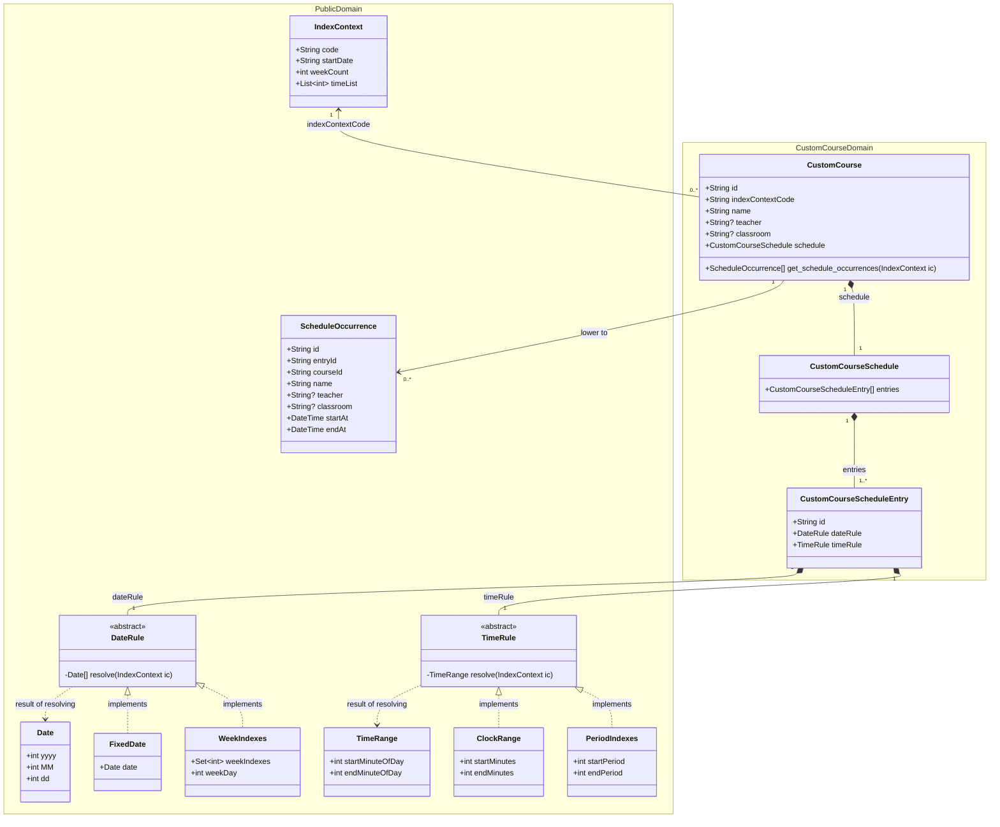

# 自定义课程数据流程重构方案

> **结构说明：** 本文早于当前[项目架构](../../../.agents/skills/pda-v2-coding-principles/references/architecture.md)的文件组织调整。下文提到的固定分层目录、feature 内的 Repository 接口及 `drift_repository.dart` 路径不再是实现要求。实现时以 `*.model.dart`、`*.case.dart`、`*.store.dart`、`*.widget.dart` 标记主要职责；本地读写由用例或具体 store 负责，网络接口放在 `pda_repository`。下文的课程规则、表结构及事务要求仍有效；第 6.7 节历史数据迁移不适用于 v2 新实现。

## Table of Contents

- [自定义课程数据流程重构方案](#自定义课程数据流程重构方案)
  - [Table of Contents](#table-of-contents)
  - [一、背景](#一背景)
  - [二、目标](#二目标)
  - [三、整体架构设计](#三整体架构设计)
    - [3.1 Core](#31-core)
      - [Database](#database)
      - [ID](#id)
  - [四、Domain Model](#四domain-model)
    - [4.1 对象关系](#41-对象关系)
    - [4.2 规则与校验](#42-规则与校验)
    - [4.3 学期归属](#43-学期归属)
  - [五、Data Design](#五data-design)
    - [5.1 连接和读写](#51-连接和读写)
      - [文件划分](#文件划分)
      - [调用关系](#调用关系)
      - [初始化和生命周期](#初始化和生命周期)
    - [5.2 表结构](#52-表结构)
    - [5.3 存储和校验约定](#53-存储和校验约定)
    - [5.4 Repository 事务边界与原子操作](#54-repository-事务边界与原子操作)
      - [创建新的课程](#创建新的课程)
      - [修改已有课程](#修改已有课程)
      - [删除已有课程](#删除已有课程)
      - [删除所有已有的课程](#删除所有已有的课程)
      - [清除指定学期以外的课程及上下文](#清除指定学期以外的课程及上下文)
      - [删除已有课程的一个 entry](#删除已有课程的一个-entry)
      - [通过课程 Id 查找课程](#通过课程-id-查找课程)
      - [创建新的学期上下文](#创建新的学期上下文)
      - [删除已有学期上下文](#删除已有学期上下文)
      - [修改已有学期上下文](#修改已有学期上下文)
      - [查询所有学期上下文](#查询所有学期上下文)
      - [使用学期上下文 code 查找课程](#使用学期上下文-code-查找课程)
      - [使用学期上下文 code 订阅课程](#使用学期上下文-code-订阅课程)
  - [六、Application Use Case](#六application-use-case)
    - [6.1 清除指定学期以外的课程及上下文](#61-清除指定学期以外的课程及上下文)
    - [6.2 日程查询与学期全量订阅](#62-日程查询与学期全量订阅)
      - [单次全量查询](#单次全量查询)
      - [学期全量订阅](#学期全量订阅)
    - [6.3 创建课程](#63-创建课程)
    - [6.4 修改课程](#64-修改课程)
    - [6.5 查询课程原始数据](#65-查询课程原始数据)
    - [6.6 删除课程](#66-删除课程)
    - [6.7 迁移旧自定义课程数据](#67-迁移旧自定义课程数据)
    - [6.8 清空所有学期上下文及课程](#68-清空所有学期上下文及课程)
    - [6.9 删除课程的一个 entry](#69-删除课程的一个-entry)
  - [七、Presentation](#七presentation)
    - [7.1 当前学期共享日程](#71-当前学期共享日程)
    - [7.2 pages：完整流程与页面状态](#72-pages完整流程与页面状态)
    - [7.3 widgets：可嵌入的课程界面](#73-widgets可嵌入的课程界面)
  - [八、Integration](#八integration)
    - [输出就绪、重试与原生协议](#输出就绪重试与原生协议)
    - [退出账号与数据清理](#退出账号与数据清理)
  - [九、未实现的功能](#九未实现的功能)
  - [十、额外要求](#十额外要求)

## 一、背景

旧版 `CustomClass` 只保存具体起止时间，无法保留周次和节次规则。JSON 文件读写已由 `CustomClassRepository` 承担，`CustomClassController` 负责内存状态、编辑和查询，同时首页、提醒、日历及原生 Widget 仍分别处理时间段。重构需要保留原始规则、统一日程生成，并替换学期变化时自动清空自定义课程的行为。

## 二、目标

1. 支持「具体日期或周次」与「自由时间或节次」的四种排课组合。
2. 每门课程关联所属学期的 `IndexContext`，切换学期保留课程，只有用户主动删除课程或其最后一条安排时才移除课程。
3. 使用 Drift 和 SQLite 保存原始规则，统一生成日程供课表、首页和外部设施使用。
4. 首期只重构自定义课程。教务课表、考试和实验由各自功能负责。

## 三、整体架构设计

第三章定义依赖方向，第四、五章定义模型与存储契约，第六章定义业务编排，第七、八章定义接入，第九章用于验收。后文引用已有约定时，继承其全部校验和失败语义，使用 `try catch` 错误流传递。

依赖方向遵循[项目架构](../../../.agents/skills/pda-v2-coding-principles/references/architecture.md)。自定义课程位于 `lib/features/custom_course/`。Domain 定义课程规则与日程展开，Repository 声明持久化和历史文件操作接口，Data 实现接口。校历由本功能的 ports 描述所需字段，顶层 Integration 从提供方的公开入口接入。

Application 编排写入用例，将 Repository 发出的规则交给 Domain 展开，对外公开只读查询与订阅。Presentation 持有编辑草稿与交互状态。启动装配按账号生命周期创建共享读取，并向各消费方注入适配器。

### 3.1 Core

#### Database

`integration/database/` 从各功能的公开入口组合 Drift 表。`integration/setup/` 打开共享连接，向课程 Data 注入访问自身表所需的查询和事务能力，并管理连接生命周期。通用连接能力可以放在 Core；Data 不导入 Integration，Core 不引用功能表。连接初始化、外键和关闭要求见 5.1。

#### ID

`core/id/generator.dart` 提供一个通用 ID 生成算法，供需要新建持久实体 ID 的 feature 调用。feature 显式传入固定的类型标记，使用 ASCII 字母、数字和下划线，推荐只使用小写的字母且长度控制在 3 个字符左右。ID 格式为 `01-<typeCode>-<randomHex>`：`01` 是固定两位十六进制版本号，`typeCode` 保留原样的 ASCII 字符，`randomHex` 是 16 字节安全随机数的小写十六进制表示（32 个字符）。连字符只作分隔符，不属于类型标记，请不要在类型标记中使用连字符。

```text
generateId(typeCode):
  require typeCode matches ^[A-Za-z0-9_]+$
  randomBytes = secureRandomBytes(16)
  return "01-" + typeCode + "-" + lowercaseHex(randomBytes)
```

版本号只标识 ID 格式，不表示数据修订版本，同时 ID 不包含业务数据摘要或时间戳。ID 创建后不随编辑变化，数据库用唯一约束兜底。尚未保存的 ID 若冲突，可以重新生成。已保存的 ID 不能直接更换。现有外部代码如 `IndexContext.code` 沿用原语义；由课程、entry 和起止时间确定的 `ScheduleOccurrence.id` 仍按 4.2 的规则稳定派生。

## 四、Domain Model

保存用户选择的原始排课规则，查询时生成具体日程，不持久化展开结果。课程和 entry 各有独立 ID，编辑时保留身份。

### 4.1 对象关系



`CustomCourseSchedule` 是课程内部的安排集合，不单独建表。创建这个模型的用途是用于和可能的 `SchoolCourseSchedule` 进行语义对齐，因为这个 Schedule 还可以容纳调课信息。

每条 entry 选择一个日期规则和一个时间规则，同时多个具体日期用多条 entry 表达，同一门课程的不同 entry 以及不同课程之间均允许时间重叠，暂时不做冲突拒绝或自动合并；即使时间完全相同，也保留各 entry 的独立身份。教师和教室属于整门课程，修改后影响其全部日程。

### 4.2 规则与校验

| 对象 | 约束 |
| --- | --- |
| `IndexContext` | `code` 唯一且稳定，对应学期代码；`startDate` 为第一周星期一；`weekCount` 为 1–32；`timeList` 是随该学期上下文持久化的 22 个分钟数，偶数下标为开始、奇数下标为结束，按节次递增且不重叠 |
| `CustomCourse` | ID 全局唯一，`indexContextCode` 指向已保存的 `IndexContext.code`；名称去除首尾空白后非空；教师和教室去除首尾空白，空值转为 `null` |
| `CustomCourseSchedule` | 至少一条 entry；用户删除最后一条安排时同时删除课程 |
| `CustomCourseScheduleEntry` | ID 在课程内唯一；恰好包含一个日期规则和一个时间规则 |
| `FixedDate` | 有效公历日期，不带时区和时分秒 |
| `WeekIndexes` | 周次集合非空；星期为 1–7，星期一为 1。结合所属 context 时，每项必须在 `1..=weekCount` 内 |
| `PeriodIndexes` | `startPeriod <= endPeriod` 且均为正整数。结合所属 context 时，`endPeriod <= timeList.length / 2`，并取 `timeList[(startPeriod - 1) * 2]` 和 `timeList[endPeriod * 2 - 1]` 作为起止时间 |
| `TimeRange / ClockRange` | 分钟数满足 `0 <= start < end < 1440`；自定义自由时间另限于 `08:30–21:25` |

数据合法性校验：

- 上述对象在构造时即校验数据的合法性，校验失败即不产生领域对象。
- 课程是否关联已保存 context、周次及固定日期是否落在该 context 的学期范围内、节次是否可由该 context 的 `timeList` 解析等依赖数据库当前状态的规则，由 Repository 负责在写入时在事务中校验。
- `IndexContext.code` 的全局唯一性、`CustomCourse.id` 的全局唯一性、课程关联 context 的存在性，以及 context 不可被引用课程删除等约束同样依赖数据库当前状态，由 Repository 配合数据库约束处理，而不是由领域对象构造函数判断。
- 周次日期按 `startDate + ((weekIndex - 1) * 7 + weekDay - 1) 天` 计算，使用课程所属的 context。`FixedDate` 和 `ClockRange` 展开时不读取学期索引，但是固定日期所属范围仍按 4.3 在保存时校验。
- `ScheduleOccurrence` 带有课程信息、`courseId`、`entryId` 和具体起止时间，且开始早于结束。ID 由 `courseId`、`entryId` 和起止时间拼接稳定生成，不同 entry 即使时间相同也保留为不同日程。

### 4.3 学期归属

每个学期代码至多保存一条 `IndexContext`，同学期的自定义课程共用它。从注入的学期来源读取当前选择，校历的学期代码 用来核对课表数据是否属于该学期。新建和导入课程须指定 `indexContextCode`，普通编辑不改变归属，不支持跨学期移动。

启动先打开数据库、检查旧文件是否存在并恢复已选学期，迁移未完成时遵守 6.7 的写入和输出限制。对于手动切换学期，共享读取取消旧订阅，清空旧学期在当前视图中的日程，丢弃迟到结果。后续加载失败只更新错误状态，不回滚学期选择，也不删除其他学期的课程。

启动装配按以下顺序处理所选学期的 context，并管理共享订阅的生命周期；Application 公开加载状态：

1. 已有合法 context：立即订阅本地课程并展开 Occurrence，供页面和 Integration 使用。教务课表仍可在后台刷新，同时离线或刷新失败不影响已有日程。
2. 缺少 context：先检查同学期的课表缓存。缓存可用就创建 context 并开始订阅。否则显示「学期未就绪」，等待正常的课表加载结果，不额外发起一次请求。加载仍不可用时维持未就绪，该学期不能新建自定义课程。

可用的校历 必须与所选学期代码一致、`termStartDay` 是有效开学日期，且 `semesterLength` 在 2–32 周内。**这里以周数大于 1 作为课表已发布的项目约定**，不另存发布标志。创建 context 时以未经显示周偏移的 `termStartDay` 为 `startDate`，以 `semesterLength` 为 `weekCount`，并保存默认作息。未发布课表返回的默认 1 周不能用于创建 context。

已有 context 只在同学期的**本次网络请求完整成功**后更新，且缓存回退不触发更新。若新的 `semesterLength` 大于已保存的 `weekCount`，增加周数，保留 `startDate`、`timeList` 和课程规则；相等或变小时不改动。这样已有 Occurrence 不变，即使部分日程超出教务课表当前显示的周数，也仍留在完整日程流中。开学日期或作息确需修正时，按 5.1 校验关联课程后单独更新。

校历缓存须匹配学期。未发布的结果不能覆盖可用缓存。只有当前学期的完整日程就绪后才能替换日历和 Widget 的内容。

固定日期须落在所属 context 的 `[startDate, startDate + weekCount * 7 天)` 内。Repository 在保存课程及更新 context 时校验，失败则保留原数据。

## 五、Data Design

### 5.1 连接和读写

#### 文件划分

以下路径相对于 `lib/`。共享数据库由 `integration/database/` 组合，连接由 `integration/setup/` 创建并管理。课程表和数据访问实现放在功能模块内。

| 文件或位置 | 职责 | 设计边界 |
| --- | --- | --- |
| `integration/database/` | 从功能公开入口注册业务表及首版 schema 版本，提供共享数据库实现 | 组合 schema 和连接实现；不处理功能专属查询或写入规则 |
| `integration/setup/` | 打开 `xdyou_database.sqlite`，在每个连接上启用外键并确认就绪 | 注入、持有和关闭共享连接；失败时关闭连接并向上报告；不处理课程规则或旧 JSON 导入 |
| `features/custom_course/repository/` | 声明 `IndexContext` 和 `CustomCourse` 的读取、保存、删除及订阅接口 | 使用领域类型，支持按上下文代码访问课程；不暴露 Drift 行类型或数据库事务 |
| `features/custom_course/data/local/tables.dart` | 声明 `index_contexts`、`custom_courses`、`custom_course_schedule_entries` 及约束和索引 | 只定义结构，不执行查询，不依赖数据库连接类 |
| `features/custom_course/data/mapping/mapper.dart` | 转换数据库记录与领域对象，处理日期、时间段列表、周次位图和规则字段 | 纯转换函数，校验数据库表示的格式与完整性，再构造领域对象；不执行 IO、不决定业务规则 |
| `features/custom_course/data/local/drift_repository.dart` | 实现 Repository 接口，直接使用 Drift 查询、订阅和事务写入，并调用 mapper | 保证课程与 entries 一起提交，并以数据库当前状态校验关联 context 与业务规则；不生成 occurrence、不管理 Signals 或外部同步 |
| `features/custom_course/data/legacy_source.dart` | 读取、备份和原子保存旧 JSON，保留原始字段，并按历史文件格式校验记录 | 不调用旧 Controller 或旧 Repository 的保存方法，不把迁移状态写入 SQLite |

`integration/database/` 通过功能的公开入口取得表声明以注册 schema。Repository 通过构造函数接收共享数据库连接，不自行创建连接或查找全局实例。

#### 调用关系

1. 读取：Application 调用 Repository，Repository 通过 Drift 在同一快照中取得课程、entries 及各自的 context，再交给 mapper 重建领域对象。损坏记录或缺失关联时报错，不转换为空课表。
2. 写入：Application 编排 Repository 操作，Repository 在事务中取得数据库当前状态，执行业务正确性校验，经 mapper 转换后直接使用 Drift 保存。所有写入使用同一个数据库事务。
3. 订阅：Repository 在数据变化后发出课程及 context。Application 调用领域规则重新展开日程，页面与平台输出通过同一份只读快照取得更新。

#### 初始化和生命周期

使用共享的 `XDYouDatabase`，文件为 `xdyou_database.sqlite`。启动装配负责初始化、注入依赖和最终关闭连接，页面不管理连接生命周期。

1. 在后台执行数据库操作，连接打开时启用外键。实际打开并完成首版建表后才报告就绪；失败提供重试，不删库重建。
2. 首版 schema 版本固定为 1，当前不实现数据库升级。将来改表时，再递增版本并补齐迁移和旧库验证。旧 JSON 导入独立于数据库初始化。
3. Repository 直接使用 Drift 读写，用 mapper 转换模型，mapper 不执行 IO。
4. Application 只编排业务操作；Repository 在一个事务中完成课程与 entries 的写入及业务正确性校验。失败全部回滚，不向 Application 暴露 Drift 事务。
5. 按 4.3 随教务课表自动刷新 context 时，只增加 `weekCount`，保留 `startDate` 和 `timeList`；Repository 在事务内校验其关联课程，不截断规则或删除课程。明确修正校历或作息时，将新 context 与关联课程一并校验后原子提交；若新周数容纳不下已有规则则拒绝更新，成功后重新计算受影响日程。

### 5.2 表结构

三张业务表分别保存学期上下文、课程及其归属、排课规则。Drift 定义应与以下 SQL 一致。

```sql
CREATE TABLE index_contexts (
    -- 每个学期代码对应一个上下文，尚未取得合法校历时不插入记录。
    semester_code   TEXT NOT NULL PRIMARY KEY CHECK (
                        (length(semester_code) = 11
                         AND semester_code GLOB '[0-9][0-9][0-9][0-9]-[0-9][0-9][0-9][0-9]-[1-2]')
                        OR
                        (length(semester_code) = 5
                         AND semester_code GLOB '[0-9][0-9][0-9][0-9][1-2]')
                    ),
    start_date      TEXT NOT NULL
                    CHECK (
                        length(start_date) = 10
                        AND start_date GLOB
                            '[0-9][0-9][0-9][0-9]-[0-9][0-9]-[0-9][0-9]'
                        AND date(start_date) IS NOT NULL
                        AND date(start_date) = start_date
                    ),
    -- 假定一个学期不会超过 32 周
    week_count      INTEGER NOT NULL
                    CHECK ( week_count BETWEEN 1 AND 32),
    -- 按节次排列的 22 个分钟数；偶数下标为开始、奇数下标为结束，例如 [510,555,...,1240,1285]。
    -- CHECK 只验证 JSON 外层结构；mapper 验证元素可解析，IndexContext 构造函数校验范围、顺序和重叠。
    time_list       TEXT NOT NULL
                    CHECK (CASE
                        WHEN json_valid(time_list)
                        THEN json_type(time_list) = 'array'
                             AND json_array_length(time_list) = 22
                        ELSE 0
                    END)
);

CREATE TABLE custom_courses (
    id          TEXT NOT NULL PRIMARY KEY CHECK (length(id) > 0),
    index_context_code TEXT NOT NULL,
    name        TEXT NOT NULL CHECK (length(trim(name)) > 0),
    teacher     TEXT,
    classroom   TEXT,

    FOREIGN KEY (index_context_code) REFERENCES index_contexts (semester_code)
        ON DELETE RESTRICT ON UPDATE RESTRICT,

    CHECK (teacher IS NULL OR
           (length(teacher) > 0 AND teacher = trim(teacher))),
    CHECK (classroom IS NULL OR
           (length(classroom) > 0 AND classroom = trim(classroom)))
);

CREATE INDEX custom_courses_by_context ON custom_courses (index_context_code);

CREATE TABLE custom_course_schedule_entries (
    course_id          TEXT NOT NULL,
    id                 TEXT NOT NULL CHECK (length(id) > 0),
    
    -- 0 means week_indexes; 1 means fixed_date
    date_rule_type     INTEGER NOT NULL
                       CHECK (date_rule_type IN (0, 1)),
    fixed_date         TEXT,
    -- Bit 0 means week 1, bit 1 means week 2, and so on.
    week_indexes       INTEGER,
    week_day           INTEGER,

    -- 0 means period_indexes; 1 means clock_range
    time_rule_type     INTEGER NOT NULL
                       CHECK (time_rule_type IN (0, 1)),
    -- 采用从一天的00:00开始的分钟数作为计时标准
    start_minutes      INTEGER,
    end_minutes        INTEGER,
    -- 采用 1 - 11 对应 timeList 中的节次。
    start_period       INTEGER,
    end_period         INTEGER,

    PRIMARY KEY (course_id, id),
    FOREIGN KEY (course_id) REFERENCES custom_courses (id) ON DELETE CASCADE,

    -- 只填写所选日期规则的字段，另一种规则的字段必须为空。
    CONSTRAINT valid_date_rule CHECK (COALESCE(
        (date_rule_type = 1
         AND fixed_date IS NOT NULL
         AND length(fixed_date) = 10
         AND fixed_date GLOB '[0-9][0-9][0-9][0-9]-[0-9][0-9]-[0-9][0-9]'
         AND date(fixed_date) IS NOT NULL
         AND date(fixed_date) = fixed_date
         AND week_indexes IS NULL AND week_day IS NULL)
        OR
        (date_rule_type = 0
         AND fixed_date IS NULL
         AND typeof(week_indexes) = 'integer'
         AND week_indexes BETWEEN 1 AND 4294967295 -- 2^32 - 1
         AND typeof(week_day) = 'integer' AND week_day BETWEEN 1 AND 7),
        0
    )),

    -- 分钟数与节次分别存储，不提前将节次换算为时刻。
    CONSTRAINT valid_time_rule CHECK (COALESCE(
        (time_rule_type = 1
         AND typeof(start_minutes) = 'integer'
         AND typeof(end_minutes) = 'integer'
         AND 0 <= start_minutes AND start_minutes < end_minutes
         AND end_minutes < 1440
         AND start_period IS NULL AND end_period IS NULL)
        OR
        (time_rule_type = 0
         AND start_minutes IS NULL AND end_minutes IS NULL
         AND typeof(start_period) = 'integer'
         AND typeof(end_period) = 'integer'
         AND 1 <= start_period AND start_period <= end_period AND end_period <= 11),
        0
    ))
);
```

### 5.3 存储和校验约定

- `semester_code` 原样使用课表请求采用的学期代码；`start_date` 来自校历 `termStartDay`，不叠加显示周偏移。校历或周数无效时不创建、覆盖上下文。
- 日期使用 `yyyy-MM-dd`，分钟数从当天 00:00 起算。周次存整数位图，最低位表示第 1 周；mapper 与领域模型的周次集合互转。
- `timeList` 随所属学期保存在 `index_contexts.time_list`，使用一维 JSON 数组，即 22 个分钟数，偶数下标为开始、奇数下标为结束。数据库使用 `json_valid`、`json_type` 和 `json_array_length` 校验外层必须是包含 22 项的 JSON 数组。数据库只检查 `time_list` 是包含 22 项的合法 JSON 数组，每项是不是有效时间则由应用读取时检查，mapper 只在读取数据库值时校验每项可解析为整数，随后由 `IndexContext` 构造函数校验每对满足 `0 <= start < end < 1440` 且前一对的结束不晚于后一对的开始。损坏数据报错，不回退到全局默认值。
- 新建 context 时，将 注入的默认作息中的 22 个时刻解析为分钟数，校验后与校历一起保存，之后解析节次只使用该 context 中已保存的 `timeList`。应用更新默认作息不覆盖已有学期，仅影响新建 context。
- ID 由应用生成。entry 使用 `(course_id, id)` 联合主键。课程通过非空外键关联 context，entries 不重复保存上下文代码。
- 切换规则类型时同时填写新字段并将旧字段置为 `NULL`。更新课程或 context 不使用 `INSERT OR REPLACE`，避免替换父记录影响关联数据。
- **数据库约束负责基本范围、规则组合、唯一性和外键。领域模型构造时校验自身约束；mapper 校验数据库表示；Repository 负责所属 context 的周数和节次上限等依赖数据库状态的业务正确性校验。**
- Repository 保证提交后仍存在的每门课程至少有一条 entry。整体修改课程时，空 entries 应被拒绝；显式删除单条 entry 时，若其为最后一条，则 Repository 在同一事务内删除课程。不设置「删除最后一条 entry 自动删课程」的触发器，以免整体替换 entries 时误删课程。
- 手动删除课程只级联删除其 entries；有课程引用的 context 禁止删除或修改 `code`。查询结果按起止时间排序，同时间再按课程和 entry ID 排序。

### 5.4 Repository 事务边界与原子操作

Application 只编排具有业务含义的 Repository 方法，不拼接 Drift 写操作，也不持有数据库事务。

每个 Repository 写方法返回 `Future<void>`，对应一个完整事务：提交即成功；目标不存在、ID 重复、外键限制或业务正确性校验失败，以及存储损坏、mapper 转换失败和 I/O 异常均通过错误流抛出，且全部回滚。查询方法才返回查询值。Repository 使用 Drift 的 `transaction` 建立事务，并在该事务内完成读取、校验和全部写入；不在内部开启嵌套事务。

下面的 SQL 用于定义必须保留的事务边界和执行顺序，实际实现可使用等价的 Drift API。输入输出表定义操作契约；字段映射以创建和读取示例为准，其他操作只说明差异。

> [!TIP]
> 1. Repository 在事务内取得校验所需的数据库状态，完成业务正确性校验后，通过 mapper 将领域对象转换为数据库存储值，再用 Drift 将这些值绑定到 SQL 的命名参数。`entries` 的多行 `VALUES` 由 Drift batch 生成。实际实现使用 Drift API 表达同样的操作，不直接拼接 SQL。
> 
> 2. 写事务需要在读取和校验前取得写锁，目标行为等价于 BEGIN IMMEDIATE。实际是否使用该事务模式需由 Drift/SQLite executor 的配置保证。
>
> 3. 目前的业务设计中 custom_course_schedule_entries 表对外不可见。

#### 创建新的课程

| 输入 | 输出 | 成功条件 |
| ---- | ---- | ---- |
| `newCourse: CustomCourse` | `Future<void>` | 所属 IndexContext 存在；课程 ID 不存在；课程和全部 entries 已提交 |

```sql
BEGIN IMMEDIATE;

SELECT semester_code, start_date, week_count, time_list
FROM index_contexts
WHERE semester_code = :index_context_code;
-- 未找到时抛错；mapper 重建数据库中的 context，Repository 以它校验 newCourse 的周次和节次规则。
-- [!TIP] 此处可以优化一下，可以让模块在初始化时，构建响应式的 IndexContext，后续直接使用这个 IndexContext 作为创建课程的依据。

INSERT INTO custom_courses (
    id, index_context_code, name, teacher, classroom
) VALUES (
    :course_id, :index_context_code, :name, :teacher, :classroom
);

INSERT INTO custom_course_schedule_entries (
    course_id, id,
    date_rule_type, fixed_date, week_indexes, week_day,
    time_rule_type, start_minutes, end_minutes, start_period, end_period
) VALUES
    (:course_id, :entry_id_1,
     :date_rule_type_1, :fixed_date_1, :week_indexes_1, :week_day_1,
     :time_rule_type_1, :start_minutes_1, :end_minutes_1,
     :start_period_1, :end_period_1);
-- 其余 entries 由同一 Drift batch 写入。

COMMIT;
```

mapper 的转换方向是 `CustomCourse -> custom_courses`，以及 `CustomCourseScheduleEntry -> custom_course_schedule_entries`。

| Dart 值 | SQL 字段 | 转换规则 |
| --- | --- | --- |
| `newCourse.id` | `custom_courses.id`以及每行 entry 的 `course_id` | 原样绑定为非空字符串 |
| `newCourse.indexContextCode` | `index_context_code` | 原样绑定，由外键确认对应 context 存在 |
| `newCourse.name` | `name` | 领域模型已 trim 并保证非空；mapper 原样绑定 |
| `newCourse.teacher` / `classroom` | `teacher` / `classroom` | 领域模型已 trim 并将空值转为 `null`；mapper 原样绑定 |
| `entry.id` | `custom_course_schedule_entries.id` | 原样绑定；只要求在同一课程内唯一 |
| `FixedDate(date)` | `date_rule_type = 1`、`fixed_date` | `date` 格式化为 `yyyy-MM-dd`；`week_indexes`、`week_day` 绑定为 `NULL` |
| `WeekIndexes(weekIndexes, weekDay)` | `date_rule_type = 0`、`week_indexes`、`week_day` | 周次集合压缩为整数位图，最低位为第 1 周；`fixed_date` 绑定为 `NULL` |
| `ClockRange(startMinutes, endMinutes)` | `time_rule_type = 1`、`start_minutes`、`end_minutes` | 分钟数直接绑定；`start_period`、`end_period` 绑定为 `NULL` |
| `PeriodIndexes(startPeriod, endPeriod)` | `time_rule_type = 0`、`start_period`、`end_period` | 节次序号直接绑定；`start_minutes`、`end_minutes` 绑定为 `NULL` |

- 领域构造函数在进入事务前保证课程至少有一条 entry；
- Repository 在事务内读取完整 context 后校验 `WeekIndexes` 和 `PeriodIndexes`；
- 任一写入失败时，课程行和已写入的 entry 都随事务回滚。

#### 修改已有课程

| 输入 | 输出 | 成功条件 |
| ---- | ---- | ---- |
| `newCourse: CustomCourse` | `Future<void>` | `newCourse.id` 对应的课程存在；不改变所属 context；课程和全部 entries 已提交 |

```sql
BEGIN IMMEDIATE;

SELECT c.index_context_code, i.semester_code, i.start_date, i.week_count, i.time_list
FROM custom_courses AS c
LEFT JOIN index_contexts AS i ON i.semester_code = c.index_context_code
WHERE c.id = :course_id;
-- 未找到时抛错；若新旧 index_context_code 不同则拒绝修改。mapper 重建 context，
-- Repository 在删除旧 entries 前以它校验 newCourse 的周次和节次规则。
-- [!TIP] 如上面一样，同样是可优化的。

UPDATE custom_courses
SET name = :name,
    teacher = :teacher,
    classroom = :classroom
WHERE id = :course_id;

DELETE FROM custom_course_schedule_entries
WHERE course_id = :course_id;

INSERT INTO custom_course_schedule_entries (
    course_id, id,
    date_rule_type, fixed_date, week_indexes, week_day,
    time_rule_type, start_minutes, end_minutes, start_period, end_period
) VALUES
    (:course_id, :entry_id_1,
     :date_rule_type_1, :fixed_date_1, :week_indexes_1, :week_day_1,
     :time_rule_type_1, :start_minutes_1, :end_minutes_1,
     :start_period_1, :end_period_1);
-- 其余 entries 由同一 Drift batch 写入。

COMMIT;
```

字段规范化、规则拆分和 mapper 写入映射沿用[创建新的课程](#创建新的课程)。修改的差异是：`newCourse.id` 只用于定位，不更新主键；`indexContextCode` 必须与旧值一致且不写回；完整新 entries 在删除旧 entries 后批量插入，保留各自身份。

- 领域模型拒绝空安排；Repository 在删除旧 entries 前以事务内读取的 context 完成周次和节次的业务正确性校验；两类不合法数据均不会写入数据库；
- 任一新 entry 写入失败时，事务回滚并恢复原课程及其原 entries。

#### 删除已有课程

| 输入 | 输出 | 成功条件 |
| ---- | ---- | ---- |
| `courseId: String` | `Future<void>` | 目标课程存在且已删除；其 entries 已由外键级联删除 |

```sql
BEGIN IMMEDIATE;

DELETE FROM custom_courses
WHERE id = :course_id;

SELECT changes() AS affected_row_count;
-- custom_course_schedule_entries 由 ON DELETE CASCADE 删除。

COMMIT;
```

`courseId` 原样绑定为 `:course_id`，不重建领域对象。

- `affected_row_count` 为 `0` 时抛出目标不存在错误；为 `1` 时提交。

#### 删除所有已有的课程

| 输入 | 输出 | 成功条件 |
| ---- | ---- | ---- |
| 无 | `Future<void>` | 全部课程及其 entries 均已删除 |

```sql
BEGIN IMMEDIATE;

DELETE FROM custom_courses;
-- entries 由 ON DELETE CASCADE 删除；index_contexts 保留。

SELECT changes() AS affected_row_count;

COMMIT;
```

无输入或领域对象转换；即使原本没有课程也成功完成，执行后课程及 entries 表为空。

#### 清除指定学期以外的课程及上下文

| 输入 | 输出 | 成功条件 |
| ---- | ---- | ---- |
| `keepIndexContextCode: String` | `Future<void>` | 指定 context 存在且保持不变；其他学期的课程、entries 和 context 全部删除 |

```sql
BEGIN IMMEDIATE;

SELECT semester_code
FROM index_contexts
WHERE semester_code = :keep_semester_code;
-- 未找到时抛出目标不存在错误并回滚，不执行后续删除。

DELETE FROM custom_courses
WHERE index_context_code <> :keep_semester_code;
-- entries 由 ON DELETE CASCADE 删除。

DELETE FROM index_contexts
WHERE semester_code <> :keep_semester_code;

COMMIT;
```

`keepIndexContextCode` 原样绑定为 `:keep_semester_code`。Repository 在同一事务内检查保留目标并完成两次删除，不逐门读取、重建或删除课程。

- 任一步骤失败全部回滚，保留指定学期及其他学期的原数据；不存在部分清理成功的结果。
- 没有其他学期数据时正常完成；重复调用仍成功，但保留目标不存在时必须报错，不能退化为清空全部数据。
- 订阅只在事务提交后观察到最终结果，不暴露课程已删除而 context 尚未删除的中间态。

#### 删除已有课程的一个 entry

| 输入 | 输出 | 成功条件 |
| ---- | ---- | ---- |
| `courseId: String`<br>`entryId: String` | `Future<void>` | entry 存在并被删除；若它是最后一条 entry，课程也被删除 |

这个地方的 SQL 有两个部分，一个是删除 entry：

```sql
BEGIN IMMEDIATE;

DELETE FROM custom_course_schedule_entries
WHERE course_id = :course_id AND id = :entry_id;

SELECT changes() AS affected_row_count;
```

两个部分在同一事务内执行。Drift 中直接用 Dart 判断：`affected_row_count` 为 0 时抛出目标不存在错误并回滚，否则继续；无需 SQL 触发器。

```sql
DELETE FROM custom_courses
WHERE id = :course_id
  AND NOT EXISTS (
      SELECT 1
      FROM custom_course_schedule_entries
      WHERE course_id = :course_id
  );

COMMIT;
```

`courseId`、`entryId` 原样绑定为 `:course_id`、`:entry_id`，共同定位联合主键，不重建 entry。

- 这是 entry 唯一可被单独指定的写操作，外部不直接访问 entry 表；
- 第二个 `DELETE` 以数据库实际状态判断，不依赖调用方预先计数，因此删除最后一条 entry 与删除课程保持原子性。

#### 通过课程 Id 查找课程

| 输入 | 输出 | 成功条件 |
| ---- | ---- | ---- |
| `courseId: String` | `Future<CustomCourse?>` | 找到时返回带完整 entries 的课程；未找到时返回 `null` |

同样的两步 SQL，第二步按照第一步的结果执行： 

```sql
BEGIN;

-- 至多返回一行课程及其所属 context，不重复课程字段。
SELECT c.*, i.*
FROM custom_courses AS c
LEFT JOIN index_contexts AS i ON i.semester_code = c.index_context_code
WHERE c.id = :course_id;
```

```sql
-- 仅在第一条查询找到课程时执行；每条 entry 仅返回一次。
SELECT e.*
FROM custom_course_schedule_entries AS e
WHERE e.course_id = :course_id
ORDER BY e.id;

COMMIT;
```

两条查询在同一只读事务中执行，以取得一致快照。mapper 的转换方向是「课程行 + context 行 + entry 行列表」反向重建 `CustomCourse`。

| SQL 字段 | Dart 值 | 反向转换规则 |
| --- | --- | --- |
| 第一条查询的 `c.id`、`c.index_context_code`、`c.name`、`c.teacher`、`c.classroom` | `CustomCourse` 基本字段 | `NULL` 的教师和教室保留为 `null` |
| 第二条查询的 `e.id` | `CustomCourseScheduleEntry.id` | 每一行直接重建一个 entry，按 `e.id` 顺序放入同一个课程 |
| `e.date_rule_type` + `fixed_date` | `FixedDate` | 类型为 1 时解析 `yyyy-MM-dd`；周次列必须为 `NULL` |
| `e.date_rule_type` + `week_indexes` + `week_day` | `WeekIndexes` | 类型为 0 时将位图展开为周次集合；固定日期列必须为 `NULL` |
| `e.time_rule_type` + `start_minutes` + `end_minutes` | `ClockRange` | 类型为 1 时按整数分钟重建；节次列必须为 `NULL` |
| `e.time_rule_type` + `start_period` + `end_period` | `PeriodIndexes` | 类型为 0 时按整数节次重建；分钟列必须为 `NULL` |
| 第一条查询的 `i.*` | 业务校验所需的 `IndexContext` | mapper 解析数据库表示；Repository 用其校验所有 entry 的周次和节次边界 |

- 第一条查询没有结果时返回 `null`，无需构建课程；
- 读取到缺失关联 context、损坏日期、非法位图或不完整规则列时应报错，而不是返回部分课程。

#### 创建新的学期上下文

| 输入 | 输出 | 成功条件 |
| ---- | ---- | ---- |
| `newIndexContext: IndexContext` | `Future<void>` | context code 不存在且新 context 已提交 |

```sql
BEGIN IMMEDIATE;

INSERT INTO index_contexts (
    semester_code, start_date, week_count, time_list
) VALUES (
    :semester_code, :start_date, :week_count, :time_list
);

COMMIT;
```

mapper 的转换方向是 `IndexContext -> index_contexts`。

| Dart 值 | SQL 基础字段 | 转换规则 |
| --- | --- | --- |
| `newIndexContext.code` | `semester_code` | 原样绑定为稳定且唯一的学期代码 |
| `newIndexContext.startDate` | `start_date` | 无时区 `Date` 格式化为 `yyyy-MM-dd` |
| `newIndexContext.weekCount` | `week_count` | 直接绑定为整数，范围为 1–32 |
| `newIndexContext.timeList` | `time_list` | 22 个分钟数直接编码为一维 JSON 数组；偶数下标为开始、奇数下标为结束 |

- mapper 将领域对象的 22 个分钟数编码为数据库表示，领域构造函数保证分钟范围、每对起止顺序和相邻时间段的不重叠性。
- 重复 code 或违反约束时回滚并抛错。

context 的创建、修改和删除均为内部操作，**不直接暴露 Repository 方法给用户**；准备与切换遵循 [4.3 学期归属](#43-学期归属)，删除由用户确认的清理流程触发。

#### 删除已有学期上下文

| 输入 | 输出 | 成功条件 |
| ---- | ---- | ---- |
| `indexContextCode: String` | `Future<void>` | context 存在、未被课程引用且已删除 |

```sql
BEGIN IMMEDIATE;

DELETE FROM index_contexts
WHERE semester_code = :semester_code;

SELECT changes() AS affected_row_count;
-- 被 custom_courses 引用时，外键 RESTRICT 使事务失败。

COMMIT;
```

`indexContextCode` 原样绑定为 `:semester_code`，不重建领域对象。

- 该操作不级联删除课程；若要删除课程，应先明确调用「删除已有课程」或「删除所有已有的课程」，避免内部维护动作意外丢失用户数据。
- `affected_row_count` 为 `0` 时抛出目标不存在错误；被课程引用时外键错误使事务回滚并抛出。

#### 修改已有学期上下文

| 输入 | 输出 | 成功条件 |
| ---- | ---- | ---- |
| `newIndexContext: IndexContext` | `Future<void>` | 目标 context 存在；全部关联课程在新 context 下仍合法；新 context 已提交 |

```sql
BEGIN IMMEDIATE;

SELECT c.*, e.*
FROM custom_courses AS c
LEFT JOIN custom_course_schedule_entries AS e ON e.course_id = c.id
WHERE c.index_context_code = :semester_code
ORDER BY c.id, e.id;
-- mapper 重建数据库中的课程；Repository 以 newIndexContext 校验每门课程的业务正确性，任一失败则回滚。

UPDATE index_contexts
SET start_date = :start_date,
    week_count = :week_count,
    time_list = :time_list
WHERE semester_code = :semester_code;

SELECT changes() AS affected_row_count;

COMMIT;
```

mapper 按[通过课程 Id 查找课程](#通过课程-id-查找课程)重建查询出的课程；`newIndexContext` 的字段映射沿用[创建新的学期上下文](#创建新的学期上下文)，其中 `code` 只绑定到查询条件 `:semester_code`，不修改稳定主键。

- Repository 对学期上下文的业务正确性检查是将每门课程的规则用「待写入」的 `newIndexContext` 校验：
  - `WeekIndexes` 的每个周次不得超过新的 `weekCount`；
  - `FixedDate` 必须仍落在新 context 的 `[startDate, startDate + weekCount * 7 天)` 内；
  - `PeriodIndexes` 的起止节次必须在 `1..=11` 内，并可由新的 `timeList` 的对应下标解析；
  - `newIndexContext.timeList` 的 22 个分钟数范围、每对起止顺序与不重叠性已由其领域构造函数保证；
- 全部通过后才绑定更新参数。
- `affected_row_count` 为 `0` 时抛出目标不存在错误。

#### 查询所有学期上下文

| 输入 | 输出 | 成功条件 |
| ---- | ---- | ---- |
| 无 | `Future<List<IndexContext>>` | 返回全部 context；没有记录时返回空列表 `[]` |

```sql
SELECT semester_code, start_date, week_count, time_list
FROM index_contexts
ORDER BY semester_code;
```

mapper 按[创建新的学期上下文](#创建新的学期上下文)的字段对应关系逐行反向重建 `IndexContext`：学期代码原样读取，日期解析为无时区 `Date`，周数解析为整数并由构造函数校验 1–32，`time_list` 解析为分钟数组。

- mapper 验证 JSON 为恰好 22 个整数的数据库表示，并交由 `IndexContext` 构造函数校验分钟范围、每对起止顺序、递增性与不重叠性；
- 数据库中出现损坏行时应报错，不应静默跳过或返回 `null`。

#### 使用学期上下文 code 查找课程

| 输入 | 输出 | 成功条件 |
| ---- | ---- | ---- |
| `indexContextCode: String` | `Future<List<CustomCourse>>` | 返回该 context 下的全部课程及完整 entries；没有课程时返回空列表 `[]` |

```sql
SELECT i.*, c.*, e.*
FROM index_contexts AS i
LEFT JOIN custom_courses AS c ON c.index_context_code = i.semester_code
LEFT JOIN custom_course_schedule_entries AS e ON e.course_id = c.id
WHERE i.semester_code = :semester_code
ORDER BY c.id, e.id;
```

mapper 的转换方向是 `SQL 结果 -> List<CustomCourse>`。

| SQL 字段或输入 | Dart 值 | 转换规则 |
| --- | --- | --- |
| `indexContextCode` | `:semester_code` | 原样绑定为查询条件 |
| 同一 `c.id` 的 `c.*` 行 | 一个 `CustomCourse` | 按课程 ID 分组，基本字段只读取一次 |
| 同组中的 `e.*` 行 | `CustomCourse.schedule.entries` | 按「通过课程 Id 查找课程」的规则反向重建每条 entry |
| `i.*` | 共享的 `IndexContext` | mapper 先重建；Repository 将其作为同组所有课程的业务校验输入，不包含在输出中 |

- 零行表示 context 不存在，抛错；存在 context 但 `c.id` 为空时，重建 context 并返回课程空列表 `[]`。
- `c.id` 非空而 `e.id` 为空表示课程无安排，按损坏数据报错；任一行损坏均不返回部分列表。
- 示例中的 `i.* / c.* / e.*` 表示各表的独立记录。实际使用 Drift 类型化关联结果或明确列别名，避免同名 `id` 被覆盖。

#### 使用学期上下文 code 订阅课程

| 输入 | 输出 | 成功条件 |
| --- | --- | --- |
| `indexContextCode: String` | `Stream<(IndexContext, List<CustomCourse>)>` | 首次发送该 context 及其完整课程；之后 context、课程或 entries 变化时发送重新构建后的完整值 |

Repository 使用与「使用学期上下文 code 查找课程」相同的关联查询，并以 Drift 的 `watch()` 监听 `index_contexts`、`custom_courses` 和 `custom_course_schedule_entries`。mapper 对每次结果校验数据库表示并重建领域对象；Repository 完成 context 与课程的业务正确性校验后再发出，不暴露 Drift 行类型。

- context 不存在、关联数据损坏或 mapper 校验失败时通过 stream 错误流报告；context 存在但没有课程时发送 `(context, [])`。
- 此操作始终传送指定学期的全量原始课程规则，不按日期过滤，也不展开为 Occurrence；由 Application 的课表订阅用例统一展开。

## 六、Application Use Case

非查询入口返回 `Future<void>`，调用方通过 `try/catch` 处理失败。伪代码只调用第五章已定义的 Repository 操作，每个操作自身原子提交，Application 组合多个操作时不获得跨操作回滚。

校验职责沿用 [5.3 存储和校验约定](#53-存储和校验约定)。Application 不重复课程持久化校验，迁移用例额外在转换前检查旧记录能否无损表示。以下简单 CRUD 直接调用对应 Repository 操作，继承其完整事务和失败契约，不要求为转发另建类。

### 6.1 清除指定学期以外的课程及上下文

此入口同样受 6.7 的迁移完成门禁约束；清理时暂停外部输出，完成或失败后重新读取实际数据再恢复输出。

| 输入 | 输出 | 成功条件 |
| --- | --- | --- |
| `keepIndexContextCode: String` | `Future<void>` | 指定 context 存在；其他学期的课程、entries 和 context 全部删除；指定学期的数据保留 |

直接调用 5.4 的[清除指定学期以外的课程及上下文](#清除指定学期以外的课程及上下文)。Application 不逐门删除课程，不拆分该操作的事务。

- 用户可以手动清除不需要的其他学期课程，将原先切换学期自动清除数据的选择权交给用户；确认弹窗明确说明会永久删除其他学期的自定义课程。
- 只传稳定的 context code，不需要传入整份 context。指定 context 不存在时失败且不删除任何数据；没有其他学期数据时正常完成。
- 完成后按当前查看学期重新准备订阅；若当前查看学期也被清除，按 4.3 进入 context 准备流程，不将缺失 context 当作成功空列表。

### 6.2 日程查询与学期全量订阅

#### 单次全量查询

| 输入 | 输出 | 成功条件 |
| --- | --- | --- |
| `from: DateTime`、`to: DateTime` | `Future<List<ScheduleOccurrence>>` | 调用方须提供 `from < to`；返回与 `[from, to)` 相交的日程，按开始、结束、课程 ID、entry ID 排序 |

```text
queryOccurrences(from, to):
  contexts = await repository.查询所有学期上下文()
  occurrences = []
  for each context in contexts:
    courses = await repository.使用学期上下文code查找课程(context.code)
    for each course in courses:
      occurrences += domain.resolve(course, context)
  retain occurrences where startAt < to and endAt > from
  sort occurrences by (startAt, endAt, courseId, entryId)
  return occurrences
```

- 本查询按需展开已保存规则，不持久化 Occurrence。只有实际测量发现查询或启动耗时不可接受时，才评估索引、查询范围或缓存；接入其他数据源本身不是增加物化表的理由。

#### 学期全量订阅

| 输入 | 输出 | 成功条件 |
| --- | --- | --- |
| `indexContextCode: String` | `Stream<List<ScheduleOccurrence>>` | context 存在；首次发送该学期全部日程，之后 context、课程或 entries 变化时发送重新展开、排序后的完整结果 |

```text
watchSemesterScheduleOccurrences(indexContextCode):
  // Application 返回该流；启动装配负责共享订阅的生命周期。
  return repository.使用学期上下文code订阅课程(indexContextCode)
    .map((context, courses) => {
      occurrences = []
      for each course in courses:
        occurrences += domain.resolve(course, context)
      sort occurrences by (startAt, endAt, courseId, entryId)
      return occurrences
    })
```

- 对「单次全量查询」不接收学期上下文条件，每门课程使用自己关联的 context 展开周次和节次规则，日期范围决定最终返回结果。这是一个保留的查询方法，实际的业务中更推荐使用相应式订阅方法，即「学期全量订阅」。
- 无匹配课程时返回空列表。多个读取操作并非全局一致快照；读取期间发生写入时，下次查询取得新结果。
- 学期订阅传送该 context 关联课程展开后的全量 Occurrence，供课表、首页及各外部输出共同使用。启动装配管理订阅生命周期，Application 公开加载状态。
- Widget、首页和其他外部输出不另开数据库订阅，也不订阅日期范围数据；各自从学期全量结果中筛选所需日期。
- 后续可按需要补充以 `indexContextCode` 与周数为输入的查询入口；本期不定义该接口或实现。

### 6.3 创建课程

| 输入 | 输出 | 成功条件 |
| --- | --- | --- |
| `newCourse: CustomCourse` | `Future<void>` | 目标 context 存在；课程及至少一条合法 entry 原子保存 |

直接调用 5.4 的[创建新的课程](#创建新的课程)，不拆分其数据库操作。

- 创建入口明确携带 `indexContextCode`，不隐式使用当前查看学期，也不以今天代替无效校历；目标 context 是否存在由 Repository 校验。
- 名称、教师和教室的规范化以及空安排、非法日期或时间的拒绝由领域模型构造完成。四种日期规则与时间规则组合均保留原始规则，不提前展开存储。

### 6.4 修改课程

| 输入 | 输出 | 成功条件 |
| --- | --- | --- |
| `newCourse: CustomCourse` | `Future<void>` | 课程存在且所属学期不变；完整新课程合法并已提交 |

直接调用 5.4 的[修改已有课程](#修改已有课程)，不拆分其数据库操作。

- 这是提交完整课程的替换语义，不是部分字段补丁。
- 删除某条安排通过提交剩余 entries 完成。修改到零条安排不可能被触发，因为空 entries 在领域模型构造时即被拒绝。
- 当前 Data 层没有单独更新 entry 的操作。如后续需要差量写入，应先在第五章定义相应原子操作，完整聚合校验不因此改变。
- 首期不考虑并发编辑，不增加编辑版本检查或冲突处理。

### 6.5 查询课程原始数据

| 输入 | 输出 | 成功条件 |
| --- | --- | --- |
| `courseId: String` | `Future<CustomCourse?>` | 存在时返回完整课程及原始 entry 规则；不存在时返回 `null` |

直接调用 5.4 的[通过课程 Id 查找课程](#通过课程-id-查找课程)，不拆分其数据库操作。

- 用于详情及编辑课程信息的初始化，使用 Occurrence 携带的 IDs 查询。
- 已有课程的 context 缺失、规则损坏或无 entries 时抛错，不能当作课程不存在。页面编辑历史课程时使用其所属 context，不能按当前查看学期过滤安排。

### 6.6 删除课程

| 输入 | 输出 | 成功条件 |
| --- | --- | --- |
| `courseId: String` | `Future<void>` | 指定课程及其全部 entries 已删除；所属 context 保留 |

直接调用 5.4 的[删除已有课程](#删除已有课程)，不拆分其数据库操作。

- 用于删除整门课程。
- 不自动清理没有课程引用的 context，其他课程及其他学期不受影响。

### 6.7 迁移旧自定义课程数据

| 输入 | 输出 | 成功条件 |
| --- | --- | --- |
| 旧文件读取、备份和保存能力，ID Generator，课程 Repository | `Future<MigrationReport>` | 旧课程全部满足新规则并已导入，旧文件已删除 |

用户在迁移页面主动开始转换。应用启动时只检查 `CustomClassesV2.json` 是否存在。文件存在或检查失败时，普通课程的创建、编辑、删除、清空和平台输出暂不开放。用户仍可切换学期、加载课表并准备 `IndexContext`。

首次转换前，把旧文件的原始字节备份到 `CustomClassesV2.json.bak`。备份成功后才允许修改旧文件或写数据库。备份只创建一次，迁移页面提供导出入口。后续重试始终读取当前的 `CustomClassesV2.json`，不从备份重新导入。

迁移功能自己读取原始字节并解析 JSON，保留每条课程及时间段的原始字段和顺序。文件不存在时直接结束。读取器按历史格式校验字段。迁移用例只补充新模型要求的校验，包括学期归属、日期范围和时间精度。迁移读取器只复用旧模型需要的解析与规则，不复制旧 Controller 的状态、保存和 Widget 同步逻辑。

`MigrationReport` 列出每条问题记录的位置、可读取的课程名、出错字段和原因。迁移页面为可以识别的课程提供编辑表单。表单可修改名称、教师、教室、日期和时间段，并复用创建课程页面的选择组件。用户也可以在已有学期上下文中选择课程归属，选择结果写入旧文件的 `_migrationContextCode`。无论是自动匹配还是用户选择，保存前都要确认每个时间段都落在该学期的 `[startDate, startDate + weekCount * 7 天)` 范围内。若文件本身不是合法 JSON 数组，或某条记录无法显示为课程表单，页面说明文件级或记录级错误，并提供原文件及备份的导出入口，供用户在应用外修正后重试。

用户在表单中保存时，迁移功能只修改对应的原始 JSON 记录，保留其他记录和不认识的字段。先校验表单，再用同目录临时文件原子替换 `CustomClassesV2.json`。写入成功后才显示「已保存」。写入失败时保留页面草稿并显示错误。应用强制退出只会丢失未保存的草稿，下次从最后一次成功保存的旧文件继续。迁移执行与表单保存串行进行，避免互相覆盖。

所有课程通过旧模型与新规则的校验后，才开始写数据库。一门课程必须唯一归属一个学期，或由用户明确选择一个合法的学期。迁移不自动推断周次规则。每个旧时间段都转为 `FixedDate + ClockRange`。时间段必须在同一天，开始早于结束，且位于 08:30–21:25。秒、毫秒和微秒直接忽略。空数组无需校历，可以直接完成迁移。

迁入数据库的课程和 entry 都使用第三章的 ID Generator 生成新 ID。首次通过全部校验后，迁移用例通过 Repository 检查生成的课程 ID 是否已在数据库中使用，并检查本批次的课程 ID 和同一课程内的 entry ID 是否重复。新生成的 ID 若冲突，就重新生成。全部确认可用后，在原始 JSON 中直接用新 ID 覆盖课程和每个时间段的 `id`。整个数组一次性原子写回 `CustomClassesV2.json`，成功后才开始写数据库。旧 ID 只保留在原始备份中。重试时从旧文件读取已经写入的新 ID，不再生成。写库时若仍遇到 ID 冲突，直接重新产生新的 Id 即可。

```text
execute():
  // 同一时间只允许一次迁移或表单保存。
  if 旧文件不存在:
    return 无需迁移

  确保原始备份已保存
  读取旧文件并解析 JSON
  if 文件无法解析为数组:
    返回文件级错误，保留旧文件和备份，不写数据库
  for each 原始课程记录:
    用旧模型校验可读取的字段
    检查新模型的学期归属、日期范围和时间精度
    收集字段错误和文件位置
  if 任一记录不合规:
    返回问题报告，不写数据库

  for each 所有课程和时间段:
    为全部课程及时间段生成新 ID
    检查课程 ID 是否已存在于数据库、同批次 ID 是否重复
    对新生成的冲突 ID 重新生成，直到全部可用
    原子写回覆盖了 id 的完整旧文件

  使用成功写入旧文件的 ID 构造新领域对象
  for each course:
    existing = await repository.通过课程Id查找课程(course.id)
    if existing == null:
      await repository.创建新的课程(course)
    else if existing 与 course 的完整内容相同:
      跳过，继续下一门课程
    else:
      报告冲突并停止，不覆盖数据库

  删除旧文件
  // 删除失败时旧文件仍保存新 ID，下次逐门核对后重试。
  return 已完成报告
```

**中断恢复：** 每门课程和它的 entries 由现有 Repository 方法单独提交。写入中断时，已经提交的课程留在数据库里，旧文件也保留。重试按旧文件中的新 `id` 逐门查询，内容相同就跳过，尚未入库就继续创建，内容不同就报告冲突。迁移页面只允许编辑尚未导入的记录，已入库记录以只读方式展示，避免同一 ID 的内容在重试中改变。全部课程确认已入库后才删除旧文件。

用户可以在确认并确保备份完整后放弃迁移，删除旧文件。页面明确说明未导入的课程不会自动恢复。只有旧文件成功删除后才开放普通课程入口。退出账号时清理旧文件和备份。

### 6.8 清空所有学期上下文及课程

| 输入 | 输出 | 成功条件 |
| --- | --- | --- |
| 无 | `Future<void>` | 所有课程、entries 和学期 context 已删除 |

```text
execute():
    await repository.删除所有已有的课程()
    contexts = await repository.查询所有学期上下文()
    for each context in contexts:
        await repository.删除已有学期上下文(context.code)
```

- 课程与各 context 分别独立提交，中途失败不会回滚已删除的数据；重试时重新查询剩余 context 继续清理。
- 不删除数据库文件或重建 schema，不影响教务课表、实验、考试及其他模块数据。
- 仅在旧文件已删除后开放此操作。迁移备份不作为重新导入的来源。
- 清理前暂停订阅和外部输出，等待正在执行的输出结束，阻止并发创建及学期切换。用例成功返回时所有 context 均已删除；随后由页面协调流程按 4.3 为当前学期准备新的空 context（复用清理前已验证的校历），取得空日程后恢复订阅并同步删除外部自定义课程。若 context 重建失败，显示「学期未就绪」并提供重试；课程清理成功与重新就绪失败分别反馈。部分删除失败时重新读取实际剩余数据并显示失败，不伪造空结果。

### 6.9 删除课程的一个 entry

| 输入 | 输出 | 成功条件 |
| --- | --- | --- |
| `courseId: String`、`entryId: String` | `Future<void>` | 指定 entry 已删除；若它是该课程最后一条 entry，课程也已删除 |

直接调用 5.4 的[删除已有课程的一个 entry](#删除已有课程的一个-entry)，不拆分其数据库操作。

- 用于删除一整条排课规则。`FixedDate` entry 只影响一次上课；`WeekIndexes` entry 会删除其全部周次，不能沿用旧「删除一个时间段」仅影响一次上课的暗示。确认弹窗展示受影响周次和次数；若是最后一条安排，明确说明整门课程也将删除。
- 首期不提供「仅删除本次」快捷操作；用户可进入编辑页调整周次集合。仅删除某次日程不能直接调用此接口。Repository 删除不需要调用方预先读取、构造或提交整门课程。
- `entryId` 仅在 `courseId` 的范围内有意义。目标 entry 或课程不存在时由 Repository 通过错误流报告。
- 这是 6.4 整体替换课程以外的窄修改入口；它不修改课程名称、教师、教室或其他 entry。

## 七、Presentation

### 7.1 当前学期共享日程

Application 提供当前账号、学期及版本对应的只读快照，区分加载、失败、成功空列表和非空结果。启动装配在账号启动时创建共享订阅，在切换学期时取消旧订阅并丢弃迟到结果。页面首次打开前，外部服务即可取得相同快照。

页面按周或日期筛选展示内容，编辑时通过 6.5 查询原始规则。缺少 context 时显示未就绪状态，准备流程见 4.3。

### 7.2 pages：完整流程与页面状态

课程编辑页新建时接收目标 `indexContextCode`，编辑时接收 `courseId`，通过 6.5 加载原始课程及其所属学期，再建立页面内的响应式表单草稿。名称、教师、教室和各条安排的输入，以及保存中的状态和错误，仅由该页面持有。保存时由页面状态对象构造领域对象并调用 6.3 或 6.4；领域构造失败和用例抛错由页面捕获并展示，只有成功后才退出。Presentation 不自行判断依赖数据库状态的业务正确性。

整门课程删除、单条 entry 删除分别调用 6.6、6.9，确认和失败反馈由发起操作的页面负责。清空全部学期数据须明确提示影响范围后调用 6.8；清除其他学期时调用 6.1。迁移页面显示旧文件读取、学期匹配或时间转换失败的原因。可识别的课程可以在表单中修正并保存，文件级错误提供原文件和备份导出。页面还提供重试和确认放弃入口。只有旧文件成功删除后才开放普通编辑及手动重建入口。迁移未完成时不把数据库里的课程当成完整日程输出。

仅完整界面需要独立页面和路由；应用的路由表负责注册入口，功能页面处理自己的参数与流程。现有课表主页面仍由课表功能持有，自定义课程页面不接管整张课表的页面状态。

### 7.3 widgets：可嵌入的课程界面

课程详情卡、安排列表以及日期、周次、节次和自由时间选择器属于可复用组件。它们接收明确的领域数据、`ScheduleOccurrence` 或必要的 ID；需要操作时调用所属页面提供的回调，独立使用的组件则由自身的局部状态对象调用用例。组件只保留自身交互状态，输入值发生变化时通知持有草稿的页面，不再维护另一份课程真值。

详情卡展示课程和全部安排，提供编辑、删除单条安排和删除整门课程的入口。日期选择器保留草稿中的 entry ID，对非法日期显示错误。设置中的清空操作经确认后调用 6.8。

## 八、Integration

跨模块适配位于 `lib/integration/dispatcher/`，按消费方组织。课表与首页分别声明读取所需日期日程的 port。`integration/dispatcher/` 实现这些 port，委派给自定义课程的公开查询，并在语义不同时适配结果；`integration/setup/` 将实现注入消费方。提醒在重排时读取一次快照，日历与原生 Widget 订阅就绪结果。这些消费者共享同一账号和学期的日程来源，独立于页面生命周期。

### 输出就绪、重试与原生协议

- 读取结果带学期代码和数据版本，区分加载、错误、成功空列表和非空列表。迁移或 context 未就绪、数据加载失败时，暂停提醒和日历的替换式输出。提醒的重排与日历的事件生成、自动同步判断，均使用同一次就绪快照。成功空列表仍须清除旧输出，但不主动触发提醒重排。
- 日历和原生 Widget 串行写入，排队时合并为最新版，调用平台前核对学期与版本。平台调用期间数据变化，则完成后再写最新版。失败保留待同步状态，在数据变化、应用恢复或手动刷新时重试，仅成功后记录已同步版本。提醒仍沿用原有重排和重试入口。
- 原生投影改用 `CustomCourses.json`，沿用旧版 `CustomClassesV2.json` 的顶层课程数组格式：课程包含 `id`、`name`、可空的 `teacher/classroom` 和 `time_ranges`，每个时间段包含 `id`、`start_time`、`end_time`。将当前学期展开的每次日程写成时间段，时间沿用旧版可解析的本地 ISO 8601 格式。同目录临时文件原子替换后刷新 Widget，iOS App Group 桥接也要支持替换。

### 退出账号与数据清理

账号退出用例协调单账号范围的数据清理：用户确认后先写独立标记 `CustomCourseCleanupPending`，关闭写入口和监听，等待在途数据库及平台输出结束。然后用 Repository 清空课程、entries 和 contexts，删除旧文件、备份、新版投影及临时文件，并清理 iOS App Group 副本。同步 `loggedIn=false`、刷新 Widget，再清空内存、凭据和偏好。全部成功后移除标记，不删除共享数据库文件或重建 context。

失败时保留标记，下次启动先幂等重试清理，再初始化账号数据。清理期间禁止旧任务写回上一账号数据。

## 九、未实现的功能

这个表中总结了明确不会在本次重构中做的功能，这些功能可能会在之后的开发中慢慢引入。

| 功能 | 理由 |
| ---- | ---- |
| 不做时间冲突检测或自动合并 | 同一课程的不同安排、不同课程之间都允许时间重叠；时间完全相同的安排也保留为独立条目 |
| 不做「仅删除这一次上课」 | 删除一个 entry 会删除它覆盖的整组安排；删除周次规则中的某次日程，用户需编辑周次集合 |
| 不支持把课程移动到另一个学期 | 新建或导入时指定学期，普通编辑不能改变归属 |
| 不保存展开后的日程 | 数据库存储原始规则，查询或订阅时生成 ScheduleOccurrence；暂不做物化表、缓存或按日期范围订阅 |
| 不自动创建缺失的学期上下文 | 没有可用校历时，该学期保持未就绪，不能新建课程，也不额外发起一次课表请求 |
| 不因缓存结果更新已有 context | 自动更新只接受本次完整成功的网络结果；周数只增不减，不自动修改开学日期或作息 |
| 不迁移时区精度不明或信息有损的旧记录 | 不能确认本地时间含义、或存在跨日、秒级精度等无法无损表示的数据，会进入迁移问题列表，不静默截断或四舍五入 |
| 不自动推断旧课程的周次规则 | 旧数据迁移为具体日期加自由时间；不猜测它原先是否每周重复 |
| 不在迁移完成后持续同步新旧数据 | 新版编辑不会回写旧 JSON，旧文件仅用于一次性导入 |
| 不让教务课程、考试和实验立即切换到新模型 | 首期只重构自定义课程，其他数据源逐步迁移 |
| 不在首期建立未实际使用的远端数据接口或适配器 | 文档允许未来把远端业务模型放在 Domain，但当前没有真实数据源需求 |
| 不支持多个账号共享同一份自定义课程库 | 首期按单账号数据范围处理，登出时清除自定义课程数据 |
| 不开放迁移完成前的普通课程编辑和外部输出 | 可在校历准备好后重试，或确认放弃旧文件；旧文件删除后才开放普通入口 |
| 不在登出时删除共享数据库文件 | 只清理本功能的课程、entries、contexts 和相关投影及备份，保留其他功能的数据及数据库 schema |
| 不在首期实现数据库升级迁移逻辑 | 首版 schema 定为 1；将来修改表结构时再加版本升级方案 |
| 不要求每项业务都拆成独立类或文件 | 文档明确允许按复杂度裁剪分层；例如 Repository 直接承担 DAO 与事务职责 |
| 不为课程编辑加入并发冲突处理 | 首期不做编辑版本检查或并发编辑协调 |
| 不在重构中顺带改造其他功能 | 实验、考试和教务课表继续使用现有模型及流程；仅在自定义课程接入点适配 |
| 不允许新版输出在来源不匹配或数据未就绪时回退读取旧 Widget JSON | 只读取当前账号与学期的投影；新投影文件缺失时显示未就绪 |

## 十、额外要求

- 为每个新增文件添加设计说明，解释其职责和设计理由，供后续重构其他模块时参考。
